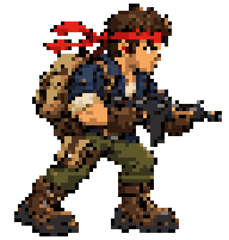

# Agent Skills

Reusable skills for AI coding agents.

[](https://skills.sh/amjadbouhouch/skills)

## Available skills

### pixel-art-toolkit

Create, edit, validate, render, animate, and convert crisp pixel-art assets with an editable text format and a zero-dependency Python tool.

```bash
npx skills add amjadbouhouch/skills --skill pixel-art-toolkit
```

Skill source: [`skills/creative/pixel-art-toolkit`](skills/creative/pixel-art-toolkit)

### agent-board

Build a persistent SQLite-backed data application — dashboard, metrics view, internal tool — with SQL migrations for schema, a declarative JSON specification for the UI, and preview-before-write commands for the data.

```bash
npx skills add amjadbouhouch/skills --skill agent-board
```

Skill source: [`skills/data/agent-board`](skills/data/agent-board) · Runtime: [agent-board](https://github.com/amjadbouhouch/agent-board)

### fleet

Coordinate AI agent sessions (Claude Code, Codex) across machines through a shared Syncthing folder: register, message, hand off context and watch an inbox. The fleet is the communication protocol; inside T3 Code the orchestrator starts sessions on any provider (Claude, Codex) with T3 Code's own thread tools, briefs them to join the fleet and report back, wakes idle workers, changes a session's model or effort, and switches a session between providers (Codex ↔ Claude) with its context handed over.

Install, or update to the latest version:

```bash
npx skills add amjadbouhouch/skills --skill fleet -g -y
```

An existing fleet folder keeps the scripts it was created with. After updating, refresh it with `node ~/.agents/skills/fleet/fleet.mjs init ~/fleet/<topic>`.

Skill source: [`skills/fleet`](skills/fleet)

## Example

| Detailed sprite | Explosion animation |
|---|---|
| [](skills/creative/pixel-art-toolkit/examples/soldier.png) | [](skills/creative/pixel-art-toolkit/examples/explosion.gif) |
| [`soldier.pix`](skills/creative/pixel-art-toolkit/examples/soldier.pix) | [`explosion.pix`](skills/creative/pixel-art-toolkit/examples/explosion.pix) |

| Coin animation | Shading stages |
|---|---|
| [](skills/creative/pixel-art-toolkit/examples/coin.gif) | [](skills/creative/pixel-art-toolkit/examples/orb_stages.png) |
| [`coin.pix`](skills/creative/pixel-art-toolkit/examples/coin.pix) | [`orb.pix`](skills/creative/pixel-art-toolkit/examples/orb.pix) · [`gen_more.py`](skills/creative/pixel-art-toolkit/examples/gen_more.py) |

### product-lifecycle

Take a feature or fix from request to merged code: start a planner when the work needs one, get the user's approval on big plans, record findings and plan in the project's Notion task, have workers build to the project's `AGENTS.md`, code style and tests, review with `/code-review`, then merge locally and push. Built for a `fleet` orchestrator and its workers; works in a single session too.

```bash
npx skills add amjadbouhouch/skills --skill product-lifecycle -g -y
```

Skill source: [`skills/product-lifecycle`](skills/product-lifecycle) · Uses: [`ntn`](https://ntn.dev) for Notion, [`code-review`](https://github.com/mattpocock/skills) for review
